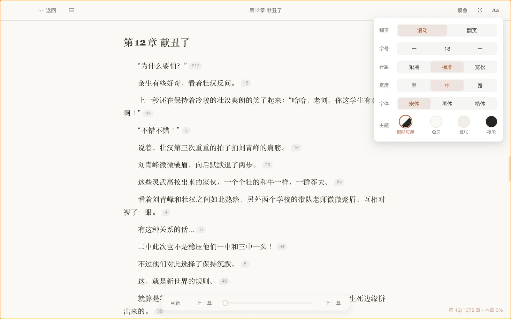
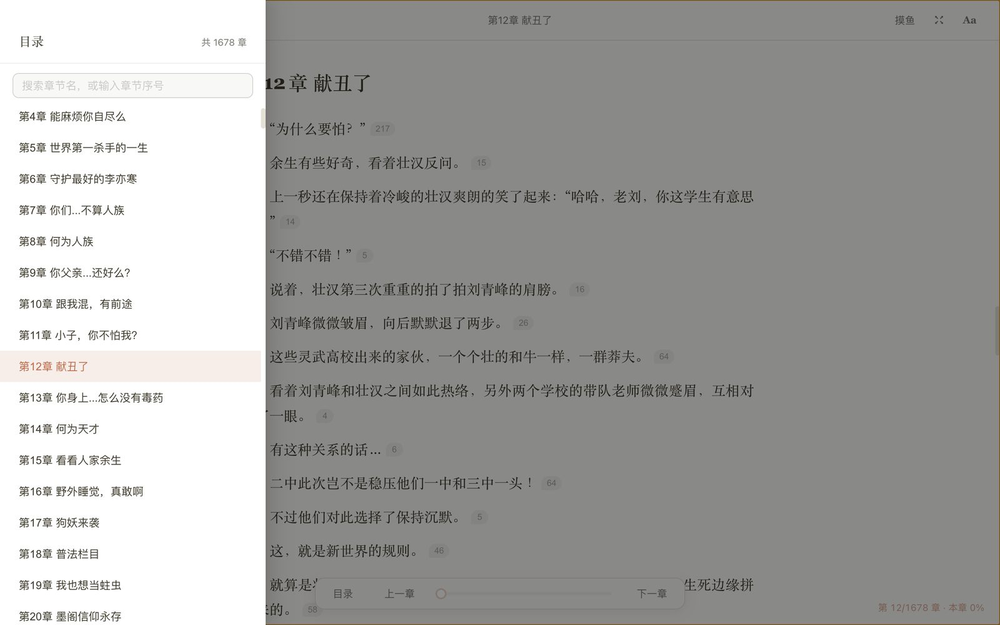
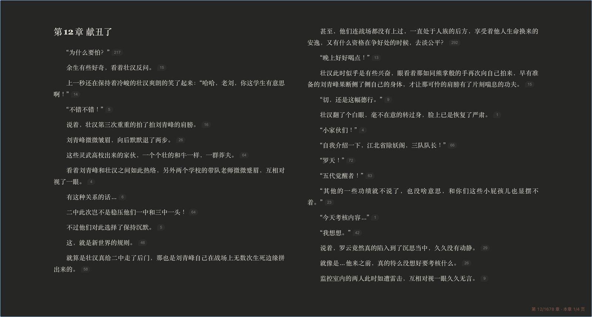
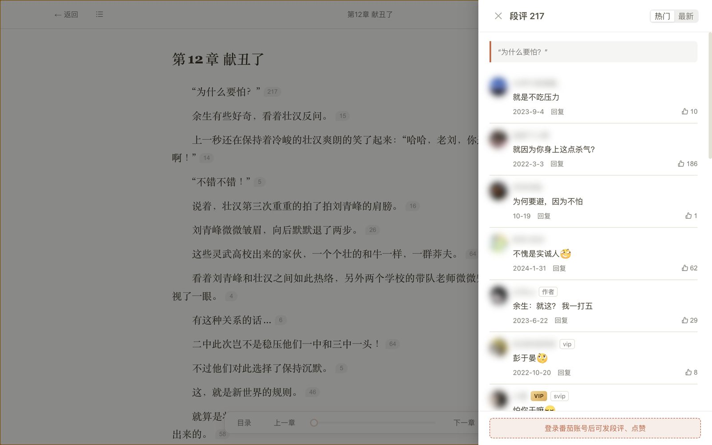
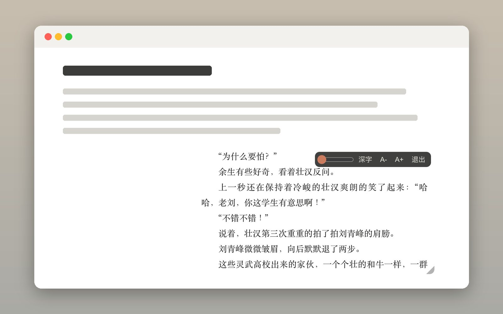

# fanqie-desktop

> 一个非官方的番茄小说桌面客户端，支持 macOS / Windows / Linux，基于 Electron + React 构建。
>
> ⚠️ **仅供学习与技术研究，严禁商用。使用前请务必阅读 [免责声明](./DISCLAIMER.md)。**


## 功能

### 发现与书架

- **发现页**：本周推荐、巅峰榜、男频 / 女频阅读榜、新书榜，以及官方分类
- **搜索**：按书名或作者搜索，优先走 App 搜索接口，失败时回退网页搜索
- **书籍详情**：简介、作者、字数、最新章节和完整目录
- **书架**：未登录也能用本地书架；用番茄小说 App **扫码登录**后，同步云书架和阅读进度
- **外观**：暖白与炭灰的低饱和配色，可选跟随系统、浅色、深色

| 书籍详情 | 书架 |
| --- | --- |
|  |  |

### 阅读器

- **正文无章节限制**：走 App 正文接口，拿到的是明文，没有网页版的字体加密，也不受网页版只能看前几章的限制
- **连续章节流**：读到章末直接接上下一章，往上滚自动接上一章，不用手动翻章
- **翻页模式**：一章排成多栏横向翻页，窗口够宽时双页并排，跨章也能连续翻
- **目录抽屉**：左侧滑出目录，可按章节名或序号搜索，不离开阅读页就能跳章
- **书签**：按 `B` 或点顶栏按钮给当前段落加书签，目录抽屉里有书签页，正文左侧标出有书签的段落
- **章内搜索**：`⌘F`（Windows / Linux 为 `Ctrl+F`）打开搜索条，高亮本章全部命中，回车 / Shift+回车逐个跳转
- **秒开翻章**：章节正文有内存和磁盘缓存，并会预取后面几章，翻章不用等接口
- **进度**：记住读到的章节和段落，底栏显示全书进度条，右下角显示第几章与本章进度
- **Aa 阅读设置**：滚动 / 翻页、字号、行距、段距、首行缩进、版面宽度、宋体 / 黑体 / 楷体，以及跟随应用、象牙、纸张、夜间四种阅读主题
- **排版**：段首缩进、两端对齐、标点避头尾，自动清理正文里的多余空白
- **沉浸阅读**：工具栏随滚动自动收起，支持全屏
- **键盘操作**：滚动模式下 ↑ / ↓ 滚动、← / → 切换章节、PageUp / PageDown / 空格翻屏；翻页模式下方向键、PageUp / PageDown 和空格都用来翻页；`F` 切换全屏，`Esc` 退出全屏或返回

| 阅读页 | 阅读设置 |
| --- | --- |
|  |  |

| 目录抽屉 | 翻页模式 · 双页 · 夜间主题 |
| --- | --- |
|  |  |

### 段评

- 每段末尾显示评论数，点开即可查看热门 / 最新段评和楼中回复
- 登录后可以点赞、发段评、回复他人
- 评论里的 `[偷笑]` 等表情代码显示成表情图，配图和动图按比例缩略显示，点击可看原图



### 听书

- **官方音频**：点阅读页顶栏的耳机按钮，从当前段落开始听，用的是番茄官方的音频
- **AI 朗读与真人主播**：音色列表分真人主播和 AI 朗读两组；真人主播只在有声书已录到的章节可用，没录到时会提示换 AI 音色
- **跟读高亮**：滚动模式下高亮正在读的段落；你停在朗读位置附近时自动往下滚，翻去看别处时不打扰
- **连续收听**：读完一章自动接下一章；可调 0.75–2 倍语速，音色和语速下次还记得
- **媒体键**：支持键盘和耳机上的播放 / 暂停、上一章 / 下一章

### 摸鱼模式

- **摸鱼小窗**：透明、无边框、始终置顶的小窗口，只显示正文；鼠标悬停时才出现控制条，可调底色透明度、字号和深浅字
- **防截屏**：在 macOS 和 Windows 上，摸鱼窗口不会出现在截图和屏幕共享中
- **无缝衔接**：从阅读页当前段落进入，退出后跳回摸鱼时读到的章节和段落
- **老板键**：全局快捷键 `⌥ + Q`（Windows / Linux 为 `Alt + Q`），一键隐藏所有窗口，macOS 上连 Dock 图标一起隐藏，再按一次恢复



### 开源与关于

侧栏底部的 GitHub 图标会打开「关于」弹窗，里面有开源地址、问题反馈入口、参考的开源项目和免责声明。

| 深色外观 | 关于 |
| --- | --- |
|  |  |

## 技术栈

| 层 | 技术 |
| --- | --- |
| 桌面容器 | Electron 42 |
| 前端 | React 18 · TypeScript · Vite 6 |
| UI | Ant Design 5 · Tailwind CSS 3 |
| 状态管理 | Zustand 5 |
| 打包 | electron-builder + GitHub Actions（macOS dmg/zip · Windows 安装包 · Linux AppImage） |

## 项目结构

```
fanqie-desktop
├── electron/                 # 主进程
│   ├── main.js               # 窗口创建与 IPC 注册
│   ├── preload.js            # 向渲染进程暴露的安全 API
│   ├── moyu.js               # 摸鱼小窗：透明置顶、防截屏、记住窗口位置
│   ├── bosskey.js            # 全局老板键
│   └── services/
│       ├── api.js            # 网页端接口：推荐、排行、分类、详情、目录、表情
│       ├── appapi.js         # App 端接口：设备注册、签名、正文解密、段评、搜索、听书
│       ├── fontdecode.js     # 网页端字体反爬解码表
│       ├── account.js        # 扫码登录、云书架、阅读进度同步
│       └── store.js          # 本地书架与设置的 JSON 存储
├── src/                      # 渲染进程（React）
│   ├── pages/                # 发现 / 搜索 / 书架 / 详情 / 阅读器 / 摸鱼
│   ├── components/
│   │   ├── Reader/           # 连续章节流、翻页视图、目录抽屉、Aa 设置面板、听书播放条
│   │   ├── CommentDrawer/    # 段评抽屉
│   │   ├── AboutModal/       # 开源与关于
│   │   └── ...               # 布局、书卡、登录弹窗
│   ├── stores/               # Zustand 状态
│   └── services/api.ts       # IPC 调用封装
├── docs/screenshots/         # README 截图
├── electron-builder.yml
└── vite.config.ts
```

## 下载安装

到 [Releases](https://github.com/MoYiC6/fanqie-desktop/releases/latest) 下载对应平台的安装包：

| 系统 | 文件 |
| --- | --- |
| macOS（Apple 芯片） | `fanqie-desktop-<版本>-mac-arm64.dmg` |
| macOS（Intel） | `fanqie-desktop-<版本>-mac-x64.dmg` |
| Windows | `fanqie-desktop-<版本>-win-x64.exe` |
| Linux | `fanqie-desktop-<版本>-linux-x86_64.AppImage` |

安装包都没有做代码签名，首次打开需要手动放行：

- **macOS**：如果提示"无法验证开发者"，在「系统设置 → 隐私与安全性」里点"仍要打开"；如果提示"已损坏，无法打开"，在终端执行 `xattr -cr /Applications/番茄小说.app` 后再打开。
- **Windows**：SmartScreen 拦截时，点"更多信息 → 仍要运行"。
- **Linux**：先给 AppImage 加执行权限：`chmod +x fanqie-desktop-*.AppImage`。

## 从源码运行

环境要求：Node.js 18 及以上。

```bash
git clone https://github.com/MoYiC6/fanqie-desktop.git
```

```bash
cd fanqie-desktop && npm install
```

开发模式（同时启动 Vite 和 Electron）：

```bash
npm run dev
```

打包当前平台（产物输出到 `release/`）：

```bash
npm run build
```

推送 `v*` 格式的 tag 会触发 GitHub Actions，在三个平台上分别打包，并自动发布 Release。

## 数据存储

| 内容 | 位置 |
| --- | --- |
| 本地书架、阅读设置 | `<数据目录>/data/*.json` |
| 登录 Cookie | `<数据目录>/data/account.bin`，经 Electron `safeStorage` 加密 |
| App 接口设备注册信息 | `<数据目录>/data/device.json` |

`<数据目录>` 在 macOS 上是 `~/Library/Application Support/fanqie-desktop`，Windows 上是 `%APPDATA%\fanqie-desktop`，Linux 上是 `~/.config/fanqie-desktop`。

## 常见问题

**正文加载失败，日志里出现 `Client network socket disconnected before secure TLS connection was established`？**

首次使用时，App 会向 `i.snssdk.com` 注册设备。部分代理软件的去广告规则会拦截这个域名，导致注册失败。请在代理规则中放行 `snssdk.com`，或临时关闭代理后再试。

## 参考的开源项目

本项目站在以下开源项目的肩膀上，在此致谢：

| 项目 | 许可证 | 用途 |
| --- | --- | --- |
| [Jees996/fanqie-novel-downloader](https://github.com/Jees996/fanqie-novel-downloader) | MIT | `electron/services/appapi.js` 由其 `core/appapi.py` 移植为 Node.js，包括设备注册、密钥交换、请求签名和正文 AES 解密流程。原版权声明保留在 [THIRD_PARTY_NOTICES.md](./THIRD_PARTY_NOTICES.md) 中 |
| [naiyQAQ/fanqie-assistant](https://github.com/naiyQAQ/fanqie-assistant) | GPL-3.0 | 上述项目的 App 网关签名与加解密算法参考了它的公开实现，本项目间接受益 |

以及构建本项目所依赖的 [Electron](https://github.com/electron/electron)、[React](https://github.com/facebook/react)、[Vite](https://github.com/vitejs/vite)、[Ant Design](https://github.com/ant-design/ant-design)、[Tailwind CSS](https://github.com/tailwindlabs/tailwindcss)、[Zustand](https://github.com/pmndrs/zustand)、[electron-builder](https://github.com/electron-userland/electron-builder) 等项目。

## 免责声明

本项目是**非官方**第三方客户端，与番茄小说及北京字节跳动科技有限公司无任何关联。本项目不存储、不分发任何小说内容，所有数据均由使用者设备直接向官方服务器请求获得。

本项目仅供个人学习与技术研究，**严禁用于商业用途或批量抓取、传播受版权保护的内容**。使用本项目产生的一切后果由使用者自行承担。请支持正版，支持作者。

完整条款见 [DISCLAIMER.md](./DISCLAIMER.md)。如有侵权，请通过 Issues 联系，核实后将第一时间处理。

## 许可证

[MIT](./LICENSE)
